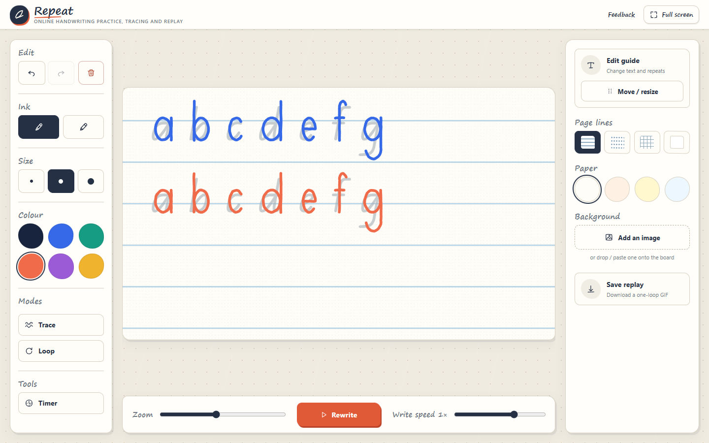
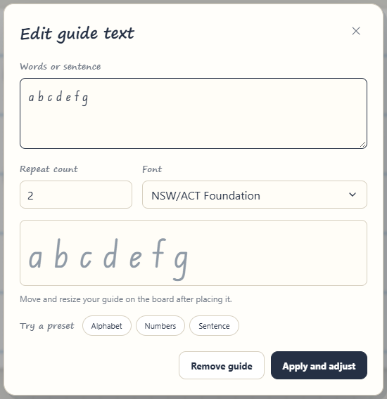

# Repeat

[](https://github.com/DanielSayer/handwriting-repeater/actions/workflows/ci.yml)

**Practise your handwriting, then watch it come back to life.**

Repeat is a free online whiteboard for handwriting practice. Write on the page, trace over letters or pictures, and then replay your writing stroke by stroke, at the speed you wrote it. When you're happy with it, save it as an animated GIF to share.

**[Try it at handwriting-repeater.com](https://www.handwriting-repeater.com/)**. Nothing to install, no account needed.



## What you can do

- **Write naturally.** Use a marker or pencil and pick any colour and thickness.
- **Practise with guides.** Turn on lined paper, or type a word and have it repeated across the page to copy. Drag guides around, resize them, and pick a handwriting font.
- **Trace a picture.** Add a photo or worksheet behind the page and fade it so it's easy to trace.
- **Watch it back.** Replay your writing at its real pace, speed it up or slow it down, or set it to loop.
- **Share it.** Save the replay as an animated GIF.
- **Made for the classroom.** Built for desktop and laptop screens, so you can project it onto the class whiteboard and write live in front of students.

<p align="center">
  <br>
  <sub>Type anything and pick a school handwriting font</sub>
</p>

Great for teachers modelling letter formation, kids learning to write, and anyone practising their handwriting.

## Your work stays yours

Repeat runs entirely in your browser. Your drawings and pictures are never uploaded anywhere. They're saved on your own device, so they'll still be there next time you open the site in the same browser.

Keep in mind:

- Clearing your browser data deletes your saved board.
- Boards don't sync between browsers or devices.

The site counts which features get used, anonymously, so I know what to improve. It never records what you write, your drawings, or your pictures.

## Feedback

Got an idea or found a bug? Click **Feedback** in the app, or use the [feedback form](https://tally.so/r/J9NaAz).

---

## For developers

Built with Svelte, TypeScript, and Vite. No backend, just a static site.

You'll need Node.js 22.12+ and pnpm 9.5.

```sh
pnpm install
pnpm dev     # start the local dev server
pnpm ci      # run every check: types, lint, tests, formatting, build
```

Other scripts: `pnpm check`, `pnpm lint`, `pnpm test`, `pnpm format`, `pnpm build`, `pnpm preview`.

**Analytics (optional):** copy `.env.example` to `.env.local` and set `VITE_PUBLIC_POSTHOG_KEY`. Without it, no analytics load.

**Deploying:** run `pnpm build` and host the `dist` folder on any static host. No server or rewrites needed.

**Code layout:**

```text
src/
├── components/  # UI and drawing board
├── lib/         # drawing, replay, saving, images, GIF export
├── App.svelte   # app state and layout
└── app.css      # global styles
public/          # icons, manifest, robots.txt
```

For performance notes, see the [September 2026 audit](docs/performance-audit-2026-09-05.md).
